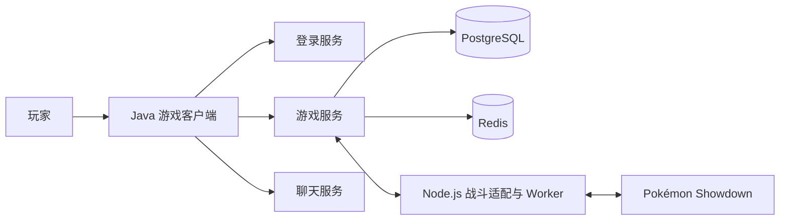

# PokeNet

### 多人游戏客户端与服务端二次开发作品集

PokeNet 是一个围绕多人游戏体验持续迭代的个人项目：以已有开源客户端和服务端为基础，扩展剧情、战斗、玩家系统与中文体验，并在实际使用中持续定位和修复问题。

这个仓库用于展示**项目背景、产品决策、技术方案和验证过程**。为保护仍在持续开发的项目，仅公开说明文档和有限代码片段，不包含完整源码与可直接部署的服务。

> **阅读导航：** [项目概览](#项目概览) · [我的参与](#我的参与) · [系统架构](#系统架构) · [二次开发内容](#二次开发内容) · [典型问题与解决](#典型问题与解决) · [测试与验证](#测试与验证) · [来源与许可](#来源与许可)

## 项目概览

原项目提供了客户端、服务端及部分基础能力。二次开发的目标是在既有基础上，逐步完善**玩家从进入世界、探索地图、触发剧情到战斗结算的体验**，同时处理多人环境中的数据一致性、断线恢复和客户端状态同步。

项目涉及的工作既有玩家直接感知的内容，例如 NPC 对话、地图交互、商店与中文文案，也有界面背后的工程问题，例如重复请求、战斗完成后的持久化和异常恢复。不同功能分批推进，实际完成与验证范围以各自案例为准。

| 项目维度 | 内容 |
| --- | --- |
| 项目类型 | 基于开源项目的多人游戏二次开发 |
| 主要技术 | Java 17、LibGDX、Netty、PostgreSQL、Redis、Node.js |
| 战斗模拟 | 对接 Pokémon Showdown |
| 构建工具 | Gradle、Maven |
| 展示重点 | 需求与规则设计、游戏业务实现、问题定位、测试与交付 |
| 当前仓库 | 脱敏后的作品集，不提供可部署的完整游戏项目 |

## 我的参与

我从玩家体验和项目整体目标出发，持续提出需求、决定优先级并参与验收。项目采用 AI 辅助开发与协作：我负责明确问题和期望行为、作出玩法取舍、提供实际使用反馈，并组织审查与验证；代码、调查和测试由人机协作完成。下面列出几类具体参与，避免将整个上游项目或全部代码误写成个人从零完成。

- **定义玩法与范围**：拆分剧情和功能阶段，明确触发条件、玩家可见行为及完成标准。例如丰缘开场选择卡车开场、统一家庭与劲敌分支、一次完成时钟交互，并简化捕获教学中的战斗环节。
- **确定规则与文本依据**：优先处理玩家可见的中文内容，选择按 Showdown 的效果解释招式；根据截图继续追踪特性和商店道具的漏译与规则表述。
- **提供实际反馈**：结合游戏体验纠正过时的问题判断。例如确认部分分支的 PvP、交易行、公会与 PvE 流程已有手测反馈；将图鉴问题进一步区分为界面需关闭重开后刷新，而不是简单归因于数据登记失败。
- **组织工程交付**：要求隔离工作树、固定版本、保护并行工作和存档；对变更进行审查，并分别记录源码、编译、自动测试和真实客户端流程的状态。

更完整的例子见 [产品决策与玩家反馈](cases/product-decisions.md)。这里记载的是实际做过的决策与介入，不将所有历史验证结果推断为当前版本的完整验收。

## 系统架构

这是按主要职责整理的概览，省略了具体协议、连接建立和部署细节。

| 部分 | 主要职责 |
| --- | --- |
| 客户端 | 地图与角色呈现、UI、玩家输入、网络消息处理和中文文本展示 |
| 登录与聊天服务 | 登录流程、节点接入以及聊天相关连接与消息 |
| 游戏服务 | 地图、角色、NPC、剧情、战斗接入、道具和玩家资产等业务 |
| PostgreSQL / Redis | 分别用于项目中的持久化数据和共享状态／消息等能力 |
| 战斗适配与 Showdown | 将游戏服务的战斗请求与模拟器连接，并将结果交回游戏业务流程 |

战斗结果、剧情进度和玩家资产不仅需要“算出结果”，还要考虑失败重试、角色归属、数据落库、重复消息和客户端展示之间的关系。这些交界处是本项目持续修复和验证的重点。

## 二次开发内容

### 1. 地图、NPC 与剧情

围绕地图移动、NPC 交互和剧情推进，对既有游戏流程进行分阶段扩展与修复。工作包括梳理触发条件、事件与地图的绑定、剧情标记、战斗结果与后续节点的衔接，以及中断后的恢复。

例如，关都路线中的劲敌与徽章岗哨需要同时处理不同入口、战斗准入、失败重试、徽章判断与路线往返。历史固定组合对组件、合成数据库和客户端文本做过定向验证；这不代表所有地图和剧情都已经完成或通过玩家实机验收。

### 2. 战斗接入与结算恢复

在 Java 游戏服务和 Pokémon Showdown 之间建立业务衔接，围绕战斗准入、模拟过程、结果投递和持久化结算处理跨组件状态。

重点包括：确认战斗结果属于正确的角色和尝试；冻结结算所需的数据；异常中断后恢复未完成步骤；避免重复扫描或重复消息造成重复奖励；将最终资产变化投影到客户端。

一次历史组合验证使用 PostgreSQL 和 Node.js，模拟结算受阻、worker 停止后重新扫描恢复，并检查单次结算、资产锁释放与重复扫描幂等。该验证有明确的测试范围，不等于所有战斗类型或真实客户端流程已覆盖。

### 3. 玩家系统与资产交互

围绕玩家日常使用的背包、道具、商店、邮件、签到、兑换与社交等模块推进功能扩展和修复。涉及资产的操作需要关注账号与角色归属、持久化事务、重复操作和客户端刷新，而不只是界面上显示成功。

这些模块的开发和验收分批进行；仓库展示的是项目工作方向，并不声称每个模块都已完整通过当前版本的端到端验收。

### 4. 客户端交互与中文体验

根据实际游戏截图和反馈，逐步处理招式、特性、道具、剧情与界面中的中文显示问题；文本解释以实际采用的玩法规则为依据。历史交付记录包括 **595 条招式说明、166 条特性说明和 38 项新增商店／可获取道具文本**，统计对应各自交付范围，不代表游戏内全部文本均已覆盖。

客户端问题也包括交互背后的生命周期。例如进度面板反复开关导致重复查询，需要结合连接、角色、在途请求、缓存、超时和迟到响应一起处理，而不能只在按钮上增加限制。

## 更多成果与专题

- [二次开发成果全景](WORK-OVERVIEW.md)：按世界剧情、战斗成长、客户端、玩家服务与工程治理梳理工作范围。
- [地图、NPC 与剧情](cases/world-and-story.md)：从关都主线到地区适配与恢复。
- [战斗与恢复](cases/battle-and-recovery.md)：模拟器接入、结果结算和断线恢复。
- [社交与玩家服务](cases/social-and-player-systems.md)：聊天、好友、分享及资产交互。

## 典型问题与解决

### 案例一：首通登记如何在中断后继续？

**场景：** 玩家赢得剧情战斗后，需要登记当时的队伍、完成仪式并返回游戏世界。如果中途断线、玩家队伍发生变化或结果被重复处理，可能出现记录不一致或流程无法继续。

**处理思路：**

1. 从经过验证的胜利结果读取队伍快照，避免事后使用已变化的当前队伍。
2. 按角色记录来源战斗、队伍快照及流程阶段，并核对账号与角色归属。
3. 在事务中提交首通标记、返回检查点与阶段更新，重复处理时保持幂等。
4. 使用持久化阶段让重新进入场景后的流程从合适的位置继续。

**验证：** 历史固定组合中，PostgreSQL 流程 4 项和冠军队伍快照 3 项通过；完整真实客户端流程未运行。[查看案例与代码片段](cases/hall-of-fame.md)

### 案例二：反复打开面板为什么会触发重复查询？

**场景：** 玩家连续打开和关闭进度面板，旧实现会清除在途状态并再次发送请求；响应稍晚到达时也可能因请求身份变化被丢弃。

**处理思路：** 以连接、会话代际和角色共同限定状态；同一身份复用在途请求，成功后短暂缓存，失败或超时后进入冷却，并在游戏事件发生时安全地使缓存失效。

**验证：** 历史固定组合的 11 项 JUnit 定向测试通过，覆盖重复开关、角色切换、超时和迟到回包等情况；旧逻辑在重复点击对照中产生第二次请求。未运行 GUI，也没有将这个修复等同于解决所有线上服务异常。[查看案例](cases/query-cache.md)

### 案例三：如何把玩家反馈转化成可验证需求？

**场景：** 功能盘点可能受旧版本台账、自动测试结果和实际游玩观察之间的差异影响。例如一个界面没有立即显示更新，不一定意味着服务端数据没有保存。

**处理思路：** 先记录玩家看到的具体行为和复现步骤，再区分数据状态、客户端刷新及版本差异；将规则选择、预期行为和验证范围写入任务，避免用猜测代替问题定位。

**实例：** 图鉴反馈明确为“关闭并重新打开后看到更新”，因此将其描述为界面刷新体验问题。部分玩法的手测证据则限定在对应分支，重登状态当时未专门观察。[查看产品决策与反馈](cases/product-decisions.md)

## 测试与验证

项目按固定版本和具体功能选择验证范围。日常工作强调保留失败结果和适用边界，避免把一次局部通过扩大成整个项目已完成。

| 层级 | 关注点 | 结果如何理解 |
| --- | --- | --- |
| 源码与调用链审查 | 入口、状态变化、依赖和异常分支 | 证明读到了什么，不等于已经运行 |
| 编译 | 使用固定源码和依赖重新生成业务产物 | 编译成功不等于功能正确 |
| 定向自动测试 | JUnit、组件回归、PostgreSQL / Node 合成场景 | 只覆盖实际执行的用例和版本 |
| 客户端流程 | 使用真实客户端操作并观察结果 | 未执行时明确标为 `CLIENT_FLOW=NOT_RUN` |

历史案例包括首通登记 7 项定向数据库／快照测试、客户端查询生命周期 11 项 JUnit，以及关都路线 23 项组件和 5 项合成 PostgreSQL／Node 测试。它们属于不同时间、不同固定组合的验证，不能相加为一次全量测试，也不能替代真实客户端手测。

当前作品集仅为文档展示，本仓库本身没有可执行的完整项目，因此**未在此仓库执行编译、自动测试或客户端流程**。

## 项目管理与协作

项目在已有代码基础上持续迭代，同时存在多个相互依赖的功能。为控制变更范围，工作以固定源码版本为基线，在隔离工作树中开展；共享逻辑先厘清职责与真实调用链，再进行修改和审查。需要数据库时使用隔离的合成测试数据，保护玩家账号、存档和其他并行工作。

日常交付会记录变更范围、测试输入、通过／失败／未验证项及恢复方式。AI 用于辅助调查、实现与测试；项目负责人负责提出目标、作出产品选择、核对反馈并决定后续优先级。

## 来源与许可

- 客户端上游：[u123510/Pokemmo2Pro-Client](https://github.com/u123510/Pokemmo2Pro-Client)，其仓库标注 GPL-3.0。
- 服务端上游：[u123510/Pokemmo2Pro-Server](https://github.com/u123510/Pokemmo2Pro-Server)，其仓库说明基于 OpenMMO。
- 战斗模拟：[Pokémon Showdown](https://github.com/smogon/pokemon-showdown)。

感谢原项目及第三方组件作者。本项目与 PokeMMO 官方无关联。各组件的版权和许可归各自权利人；本作品集对来源的说明不会改变上游许可。

## 公开范围

此仓库面向招聘和技术交流，提供项目说明、案例分析和有限代码片段，不提供完整源码、构建链、部署配置、数据库、账号数据、ROM 或游戏素材，因此不能作为完整游戏服务直接部署。公开文件仍可被阅读、下载和保存。
